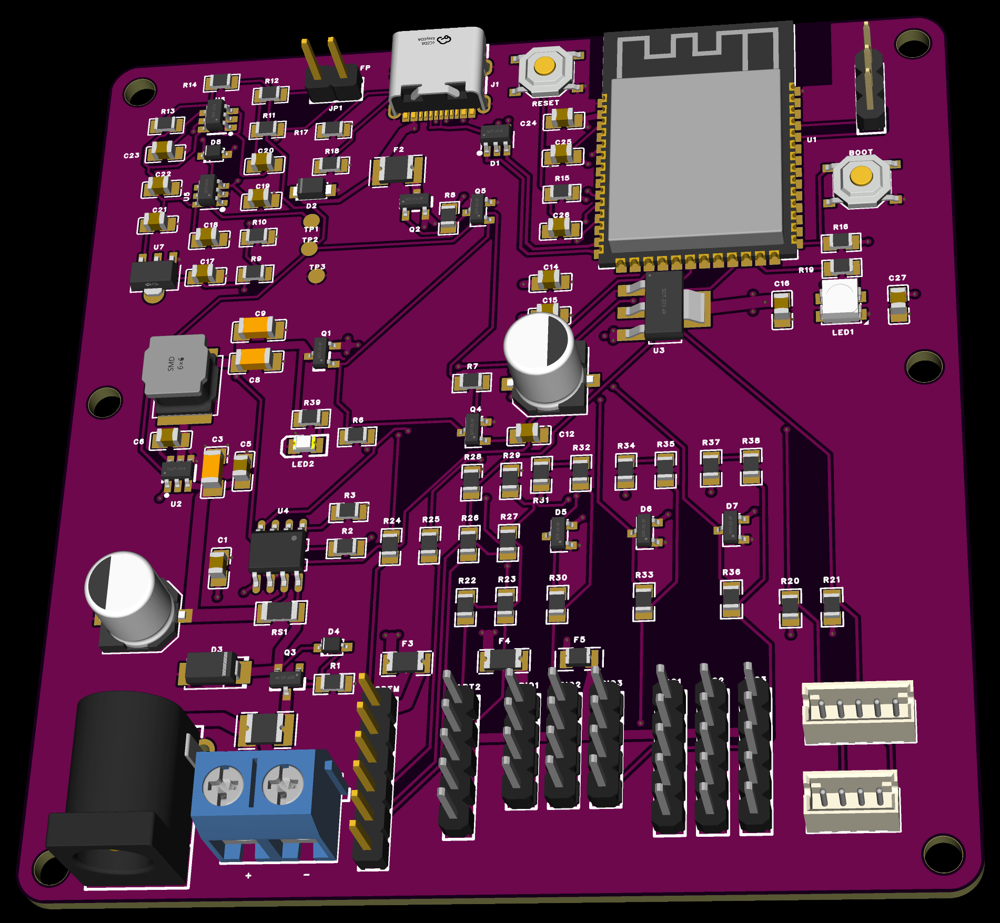
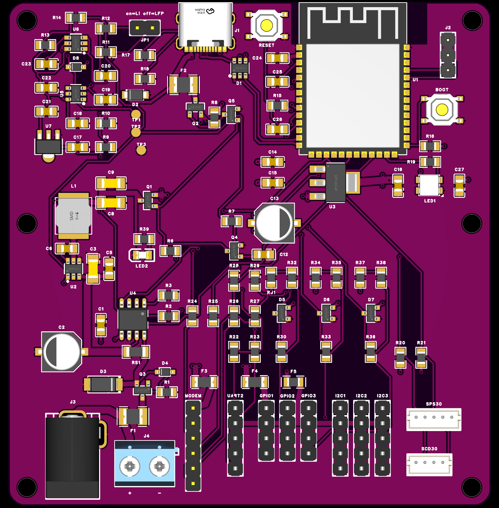
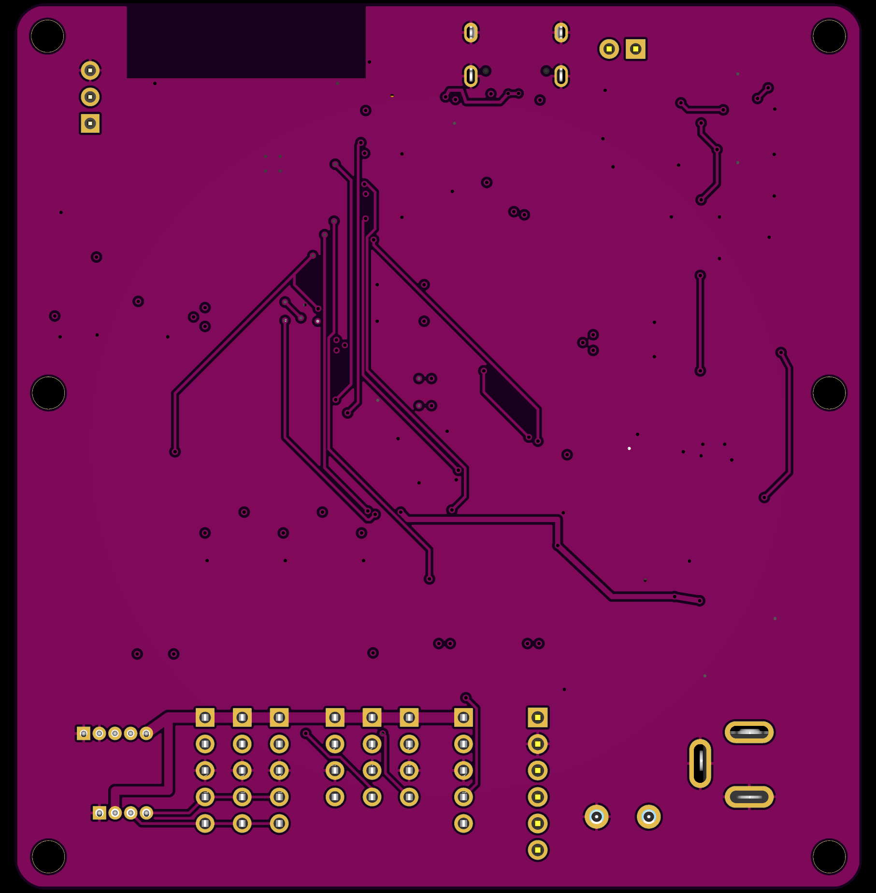

# Air360 V2 board

Air360 V2 is a single board that replaces the ESP32-S3 DevKit plus shield build. It carries the ESP32-S3 module, power from a 2S battery or USB-C, hardware battery protection, current monitoring, and the shield's sensor connectors.

**Status:** V2.2 is designed and verified on paper and on its manufacturing files. No board has been built or measured. Values below are datasheet figures or calculations unless stated otherwise.



| Top | Bottom |
|---|---|
|  |  |

*EasyEDA 3D Preview of the V2.2 board with the planned purple soldermask. Part colors are approximate.*

| Revision | State | Files |
|---|---|---|
| V2.2 | Current, cost-down, 1–1.5 A | [`release/v2.2/`](release/v2.2/README.md), EasyEDA project `Air360_V2.2` |
| V2.1 | Fallback, up to 3.3 A peak | [`release/v2.1/`](release/v2.1/README.md), EasyEDA project `Air360_V2.1` |

V2.1 has a known defect: U5 stops the board from starting on DC. Do not build it without the fix in [`DESIGN_LOG.md`](DESIGN_LOG.md) section 25.

## What it does

- Runs the Air360 firmware on an ESP32-S3-WROOM-1-N16R8.
- Takes power from a 2S battery at DC, or 5 V at USB-C. DC has priority when both are present.
- Disconnects the board at low battery voltage, and restarts only after the pack has recovered.
- Measures battery voltage and current with an INA219.
- Offers the shield's connectors at the shield's positions, so existing cables and mounting fit.

The board is 81.28 × 85 mm with six M3 holes, four of them matching the shield.

## Connections

### Power

| Connector | Use |
|---|---|
| J3, DC jack | 2S battery, Li-ion or LiFePO4 |
| J4, screw terminal | Same input as J3, for bare wires. Marked `+` and `−` |
| J1, USB-C | 5 V power, flashing and logs |

Connect J3 or J4, not both: they are in parallel with no isolation. DC takes a battery only. 5 V at DC does not start the board, and a 12 V adapter plugged in by mistake should not cause damage, though it is not an operating mode.

### Signals

Pin 1 is at the top of each header as seen from the connector edge.

| Connector | Pins in order |
|---|---|
| I2C1–I2C3 | +5V, 3V3, GND, SCL, SDA |
| SPS30 | GND, GND, SCL, SDA, +5V |
| SCD30 | GND, +5V, SDA, SCL |
| UART2 | +5V, 3V3, GND, RX2 (GPIO16), TX2 (GPIO15) |
| MODEM | +5V, GND, ESP32 RX (GPIO18), ESP32 TX (GPIO17), PWRKEY (GPIO12), SLEEP/DTR (GPIO21) |
| GPIO1–GPIO3 | +5V, 3V3, GND, GPIO4 / GPIO5 / GPIO6 |
| J2, debug | U0TXD, U0RXD, GND |

### Controls and indicators

| Part | Function |
|---|---|
| JP1 | Battery type. Jumper on for Li-ion, off for LiFePO4 |
| SW1 | Reset. Marked `RESET` on the silkscreen |
| SW2 | Boot, GPIO0. Marked `BOOT` on the silkscreen |
| LED1 | Addressable RGB LED on GPIO48 |
| LED2, green | On while the buck runs. Off on USB-only power |
| TP1, TP2, TP3 | Test pads: `VREF`, `EN_NODE`, GND |

## How it works

```text
J3/J4 ── F1 ── Q3 ── V_PROT ── RS1 ── V_BUCK ── U2 buck ── Q1 ──┐
                       │       INA219            ▲ EN            ├── +5V ── F3 ── MODEM
                       │                         │               │      ├── F4 ── sensors
                       └── UVLO: U7, U5, U6 ─────┘               │      └── U3 ── 3V3 ── ESP32
USB-C VBUS ── F2 ── Q2 ──────────────────────────────────────────┘             └── F5 ── external 3V3
```

**Input protection.** F1 limits current. Q3 blocks reverse polarity, and D3 and D4 clamp surges and limit Q3's gate voltage.

**Current monitor.** U4 reads RS1, 0.1 Ω, through separate sense tracks. Battery voltage is read at the protected node.

**Buck.** U2 converts `V_BUCK` to 5 V. It has a fixed output, so it needs no feedback resistors.

**Source selection.** While the buck runs, Q4 pulls Q1's gate low, so Q1 connects the buck to +5V and Q2 stays off. When the buck stops, Q1 opens and Q5 turns Q2 on, so USB takes over. R7 and C12 delay Q1 about 10 ms, so the buck finishes its soft start first. Q1 also blocks USB from feeding back into the buck.

**UVLO.** U7 powers the monitor directly from the protected battery node, so it stays alive when the rest of the board is off. U5 compares the battery with its reference and drives U6, which holds the buck off until the voltage has stayed good for the restart delay.

| Threshold | Li-ion | LiFePO4 |
|---|---|---|
| `V_OFF`, stops the board | 6.24 V | 6.24 V |
| `V_ON`, restarts after a stop | 7.20 V | 6.81 V |

- Restart delay is 57 s nominal, at least about 34 s. It also applies to the first start.
- Because `V_ON` sits above the recovered voltage of a discharged pack, removing load does not cause a restart loop.
- At a first connection, C20 kicks the comparator, so a charged pack starts even when it rests below `V_ON`.
- The tripped monitor draws about 30 µA by calculation, so it should not drain a parked pack quickly.

## Changing the thresholds

Change R10. `V_ON` moves with `V_OFF`.

```text
V_OFF = Vref × (1 + R9 / R10)          Vref 1.242 V nominal, R9 499 kΩ
V_ON  = V_OFF + R9 × (Vref − Vd) / Rd  Vd 0.35 V; Rd is R11, or R11 ∥ R12 for Li-ion
```

| R10 | `V_OFF` | `V_ON` LiFePO4 | `V_ON` Li-ion |
|---|---|---|---|
| 130 kΩ | 6.01 V | 6.57 V | 6.97 V |
| 124 kΩ, fitted | 6.24 V | 6.81 V | 7.20 V |
| 120 kΩ | 6.41 V | 6.97 V | 7.37 V |
| 115 kΩ | 6.63 V | 7.20 V | 7.59 V |
| 107 kΩ | 7.03 V | 7.60 V | 7.99 V |

Keep `V_OFF` above about 5.8 V. Because `Vref` varies by device, the guaranteed `V_OFF` range is 5.90–6.59 V, so measure it on the first board.

## Parts and why

| Ref | Part | Why this part |
|---|---|---|
| U2 | AP63205WU-7 | Fixed 5 V, 2 A, up to 32 V in, very few external parts. Datasheet is current (2024). MP2315 was rejected as not recommended for new designs |
| L1 | SWPA6045S4R7MT, 4.7 µH | Value from the AP63205 datasheet, saturation well above the switch limit |
| U3 | AMS1117-3.3 | Common and cheap. Enough for the measured load, with a 22 µF output capacitor as in its datasheet |
| U5 | TLV3012AIDBVR | Low-current comparator with a built-in 1.242 V reference. **Must be push-pull.** TLV3011 is open-drain and the board would not start. TLV3012B has power-on reset, and its effect on the first-start kick has not been checked |
| U6 | TPS3808G01 | Gives the long restart delay from one capacitor, C23 |
| U7 | HT7533-1 | Very low quiescent current from the battery node |
| U4 | INA219 at `0x41` | Supported by the firmware. `0x40` collides with HTU2X |
| Q1–Q3 | AO3401A | P-MOSFET, −30 V, 4 A, common SOT-23, ample for 1.5 A |
| Q4, Q5 | AO3400A | Gate logic for Q1 and Q2 |
| RS1 | 0.1 Ω, 1206, 0.25 W | Keeps the firmware's INA219 scale. Only 0.225 W at 1.5 A, so little margin at the limit |
| F1, F2 | 1.5 A PTC | Match the 1–1.5 A target |
| F3, F4 | 1.1 A PTC | Separate limits for the modem and sensors, so a short cannot drop the ESP32 |
| F5 | 0.2 A PTC | Protects 3V3 from external wiring |
| D3 | SMAJ15A | Conducts on surges, but not at 2S or a stray 12 V |
| D1 | USBLC6-2SC6 | ESD protection on USB data |
| D5–D7 | BAT54S | Clamp GPIO1–3 to 3V3, because PPD42NS can output above 4 V |
| LED1 | SK6812MINI-HS | Same kind of LED on 3.3 V as ESP32-S3-DevKitC-1. Rated from 3.7 V, so confirm it on hardware |

The target of 1–1.5 A comes from field data on the shield build: about 140 mA without a modem and 250–300 mA with one. V2.1 was sized for 3.3 A, which summed every peak at once.

## Firmware settings

- Enable INA219 at address `0x41`.
- Keep `power_gate_enabled = 0`. On USB-only power the INA219 reads about 0 V, so an enabled gate would sleep the board.

## Limits

- **Modem:** the MODEM connector is limited to 1.1 A by F3. A modem with high transmit bursts may need its own supply.
- **Solar:** the charger output must stay a 2S battery at the DC input.
- **Spare GPIO:** only GPIO1–3 connectors are brought out.
- **J3 position:** 1 mm right of the shield position, to clear an M3 head at H1. Check any enclosure cut-out.

## Not yet confirmed on hardware

- UVLO thresholds, restart delay and first start
- Buck and 3V3 stability, ripple and thermal rise
- INA219 readings at `0x41` with stock firmware
- Wi-Fi range, LED1 and LED2 brightness, cable fit

## Ordering

Files are in [`release/v2.2`](release/v2.2). Upload `gerber-v2.2.zip` and send this instruction:

```text
5PCS, 4 Layers, FR4, 1.6MM, Outer 1OZ, Inner 0.5OZ, Standard Stack-up, Purple Soldermask, White Legend, ENIG, Tented Vias, No Impedance Control, 81.28x85MM, Min Track/Space 0.15/0.10MM, Min Via 0.3/0.5MM, order number will be added on bottom side.
```

Parameters and checks before ordering are in the [release notes](release/v2.2/README.md).

## Bill of materials

See [`release/v2.2/BOM.md`](release/v2.2/BOM.md).

## Repository

| Path | Content |
|---|---|
| [`release/v2.2`](release/v2.2) | Current release: Gerbers, BOM, placement, schematic, and EasyEDA project |
| [`release/v2.1`](release/v2.1) | Fallback release with the known defect above |
| [`REQUIREMENTS.md`](REQUIREMENTS.md) | Requirements, with the V2.2 changes in their own section |
| [`DESIGN_LOG.md`](DESIGN_LOG.md) | Decisions, calculations and verification results |
| [`release/v2.2/FIRST_POWER_UP.md`](release/v2.2/FIRST_POWER_UP.md) | First power-up procedure |
| [`release/v2.2/TEST_PLAN.md`](release/v2.2/TEST_PLAN.md) | Post-assembly test plan |
